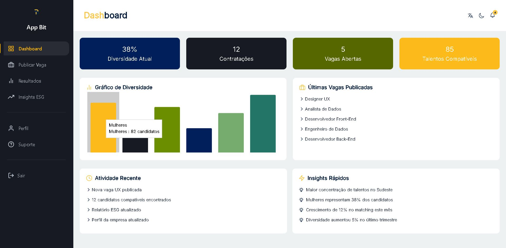
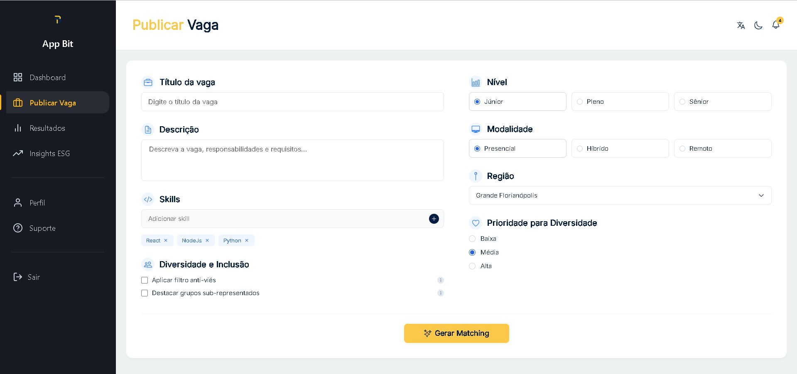
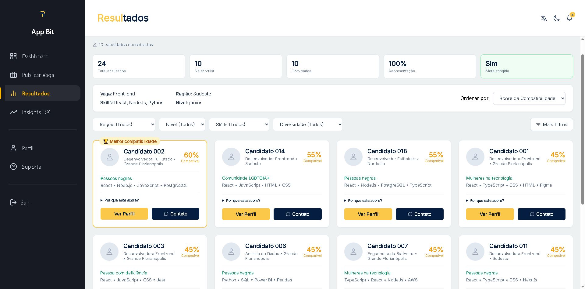
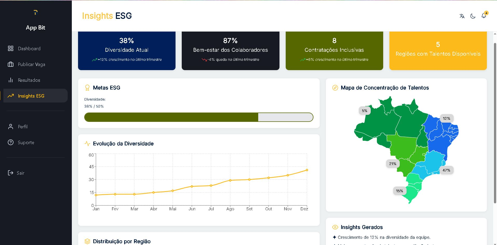
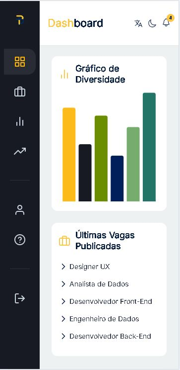

# App BiT


## Sobre o projeto

O **App BiT** é uma plataforma de Matching Inclusivo desenvolvida durante o Hackathon Wongola 2026.

A proposta é conectar empresas a profissionais de grupos sub-representados, usando dados, inteligência artificial e informações geográficas para ajudar no processo de seleção.

O projeto também apresenta indicadores relacionados a diversidade, inclusão e ESG.

## Problema

Durante um processo seletivo, as empresas podem ter dificuldade para:

- Encontrar profissionais de grupos sub-representados;
- Diminuir possíveis vieses no processo seletivo;
- Acompanhar indicadores de diversidade e inclusão;
- Analisar dados relacionados às suas metas de ESG.

## Solução

O App BiT reúne essas informações em uma plataforma onde a empresa pode:

- Cadastrar e publicar vagas;
- Definir requisitos e habilidades;
- Receber recomendações de candidatos;
- Visualizar um ranking de compatibilidade;
- Consultar indicadores de diversidade;
- Visualizar a concentração de talentos por região;
- Acompanhar informações relacionadas a ESG.

## Funcionalidades

### Autenticação

- Login empresarial
- Cadastro de empresa

### Dashboard

- Indicadores
- Gráficos de diversidade
- Visualização dos dados

### Publicação de vagas

- Cadastro de oportunidades
- Definição de requisitos
- Definição de habilidades
- Critérios de inclusão

### Matching

- Recomendação de candidatos
- Ranking de compatibilidade
- Classificação de candidatos de acordo com a vaga

### Insights ESG

- Indicadores de diversidade
- Métricas de inclusão
- Informações para apoio à tomada de decisão
- Mapa de concentração de talentos

### Perfil da empresa

- Alteração de informações
- Configurações da conta

### Suporte

- Canal de atendimento
- Abertura de chamados

## Screenshots

### Dashboard



### Publicar vaga



### Matching



### Insights ESG



### Versão mobile



## Tecnologias utilizadas

### Frontend

- Ionic React
- React
- TypeScript
- CSS

### Backend

- FastAPI
- Python

### Ferramentas

- Git
- GitHub
- Vercel
- Render
- Figma

## Arquitetura

```text
Frontend (Ionic React)
        |
        v
API REST (FastAPI)
        |
        v
Motor de Matching e Insights
```

## Deploy

### Frontend

[App BiT](https://app-bit-hack.vercel.app)

### Backend

[API](https://black-in-tech.onrender.com)

[Swagger](https://black-in-tech.onrender.com/docs)

## Equipe

| Integrante | Função |
|---|---|
| Daissa | Front-End Developer / Design Gráfico |
| Manuella Santos | Data Analyst / Front-End Developer |
| Jadson Sousa Mattos | Full Stack Developer |

## Telas desenvolvidas

- Login
- Cadastro de empresa
- Dashboard
- Publicar vaga
- Resultados de Matching
- Insights ESG
- Perfil
- Suporte

## Como executar localmente

### Frontend

```bash
cp .env.example .env.local
npm install
npm run dev
```

O frontend utiliza a variável `VITE_API_URL` para definir o endereço da API. Caso ela não seja configurada, é utilizado `http://localhost:8000`.

Após gerar o matching, o resultado fica salvo na sessão do navegador e é utilizado na tela de resultados, inclusive depois de atualizar a página.

### Backend

A API FastAPI está localizada na pasta `backend/`.

Para configurar o ambiente:

```bash
cd backend
python3.12 -m venv .venv
source .venv/bin/activate
python -m pip install -e '.[dev]'
cp .env.example .env
uvicorn app.main:app --reload
```

Mais informações sobre a configuração, testes e endpoints podem ser encontradas no [README do backend](./backend/README.md).

## Execução integrada

Para utilizar o projeto completo, primeiro inicie o backend:

```bash
cd backend
python3.12 -m venv .venv
source .venv/bin/activate
python -m pip install -e '.[dev]'
cp .env.example .env
uvicorn app.main:app --reload
```

Depois, em outro terminal, execute o frontend:

```bash
cp .env.example .env.local
npm install
npm run dev
```

## Demonstração

Vídeo de apresentação do projeto:

[Assistir à demonstração](https://youtu.be/kecfVl9KGLk?si=Eax3pLsHiRZ0gsAl)

## Hackathon Wongola 2026

O App BiT foi desenvolvido para o desafio de **Matching Inclusivo** do Hackathon Wongola 2026.

O projeto tem como foco o uso de tecnologia e análise de dados para trabalhar questões relacionadas a diversidade, inclusão e ESG.

## Licença

Projeto desenvolvido para fins educacionais e para participação no Hackathon Wongola 2026.